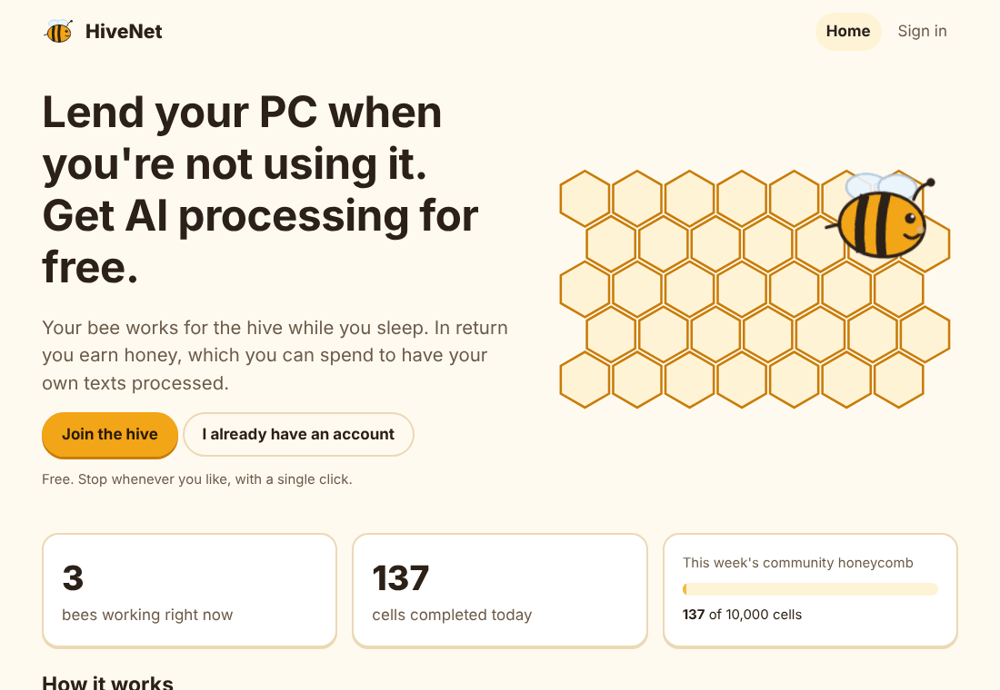
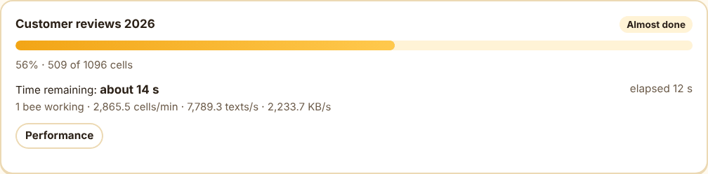
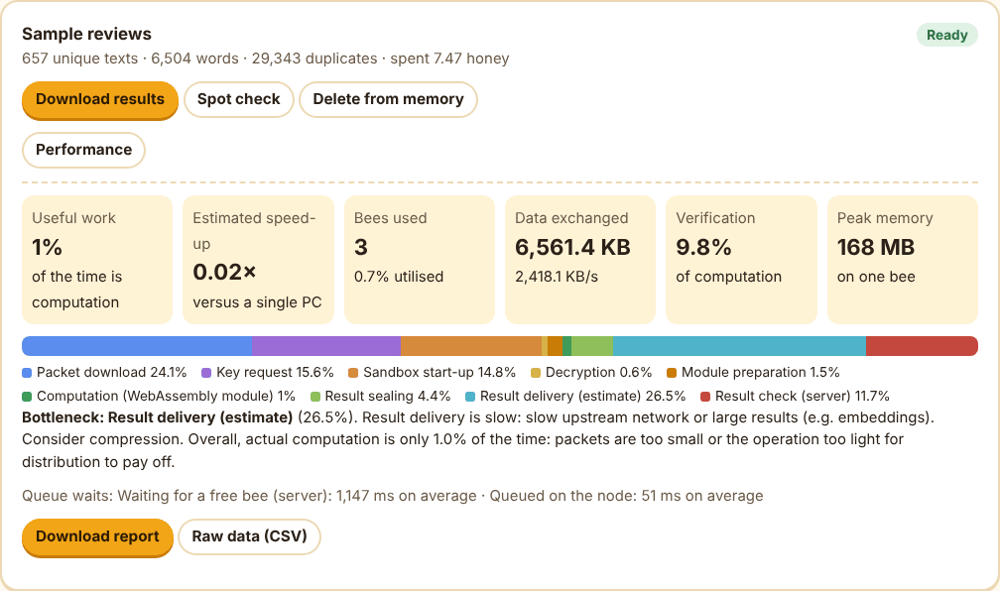
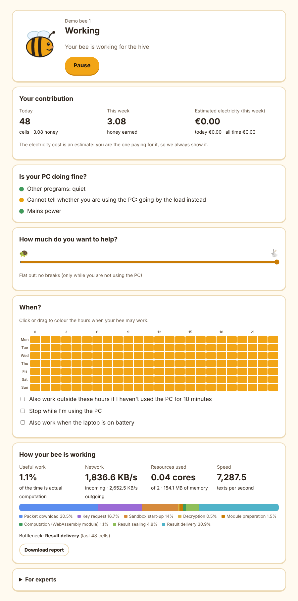

# HiveNet — a distributed computing network (V1)

A network of private PCs that, while their owners are not using them, process texts and tables together.
People who lend their PC earn **honey** (internal credits) and spend it to have their own texts processed.
The server keeps the processed results and **reuses** them: work that has already been done is never redone.

The working name is **HiveNet** (bees = nodes, honey = credits). It can be changed in `orchestrator/web/index.html`
and `bee-node/ui/index.html`.

| Document | Who it is for |
| --- | --- |
| [`TESTING.md`](TESTING.md) | How to test everything, what to check and why, how to read the performance reports |
| [`docs/PARTICIPANTS.md`](docs/PARTICIPANTS.md) | For anyone lending their PC during testing: what the bee does, how it protects the machine, what to watch out for |
| [`docs/ROADMAP.md`](docs/ROADMAP.md) | What is missing, what has been measured, and the order of the next steps |

## Screenshots

<p align="center">
  
</p>

**A job in progress**: progress, time remaining based on the real speed of the network, live throughput.

<p align="center"></p>

**The performance panel of a finished job**: where each cell's time goes, the bottleneck with advice, and the
downloadable report and raw data ([example report](docs/example-report.md)).

<p align="center"></p>

**The bee's local panel**: status, contribution, PC health, intensity, weekly schedule and the bee's own performance.

<p align="center"></p>

## Project status

| Use | Ready? |
| --- | --- |
| Testing on a single computer | Yes |
| Testing on a home or office network with trusted people | Yes, following `TESTING.md` and `docs/PARTICIPANTS.md` |
| Testing with people connecting over the internet | **Not yet**: HTTPS on the server, invitation-only sign-up and an off-server module signing key are still missing (see `docs/ROADMAP.md`) |
| Public network | No |

The V1 operations (cleaning, statistics, hashing-based embeddings) are **lightweight**: measurements show that,
today, distributing them costs more than running them on a single PC. V1 exists to exercise the network
(scheduling, verification, credits, security) and to measure where time is lost, not yet to prove that
distribution pays off (see `docs/ROADMAP.md`).

## What V1 does

| Component | What it does |
| --- | --- |
| **Orchestrator** (`orchestrator/`) | Splits jobs into cells, encrypts them, hands them out on time-limited leases, reassembles them, spot-checks results, reuses earlier results, keeps the honey ledger, the central memory and search. Measures every cell and produces performance reports |
| **Bee / node** (`bee-node/`) | Decides on its own when to work (schedule, intensity, battery, PC usage), runs cells in a sandbox and delivers results sealed for the server. Only connects to HTTPS servers. Local panel at `http://127.0.0.1:7777`, including the bee's performance |
| **Modules** (`module-src/` → `orchestrator/modules/`) | Text cleaning, personal-data removal, statistics, meaning map (embeddings). WebAssembly with no access to files, network or screen, signed with Ed25519, each declaring a memory limit (256 MB) |
| **Web panel** (`orchestrator/web/`) | Sign-up, levels and badges, linked bees, job submission with personal-data scrubbing in the browser, progress with **time remaining**, per-job **performance** with downloadable reports, spot checks, search, honey, groups of friends |

### The bee's sandbox

Cells run in a **separate process** with no environment variables, limited memory and a time limit:
- if a cell runs out of time, the process is **killed by the operating system** (SIGKILL) and recreated: nothing is left running on the PC;
- a module that declares no memory limit, declares one above 256 MB, imports system functions or is not WebAssembly is **rejected before it starts**;
- every cell gets a fresh module instance, and plain-text data is wiped at the end;
- the process is **reused** across cells with the module already compiled (starting it every time cost more than the work itself) and shuts itself down after 60 seconds without work.

### Performance metrics

Every bee times each cell: download, queueing, key request, sandbox start-up, decryption, module preparation,
computation, sealing, delivery, CPU and memory. The metrics travel **together with the result** (no extra
messages). The server adds the time the cell spent queued and the time it took to accept the result.

- **Web panel → job → Performance:** useful work, estimated speed-up, bees used, data exchanged, verification cost,
  and the bottleneck with advice on what to do. **Download report** (.md) and **Raw data (CSV)** buttons.
- **Time remaining:** computed from the actual speed over the last 90 seconds; it adapts as the network speeds up or slows down.
- **Bee panel:** a "How your bee is working" card and a downloadable bee report.

Battery status, PC usage and the load from other programs **never** leave the bee's PC.

## Requirements

- **Server:** Python 3.10 or later. Dependencies go into the isolated `.venv` environment inside the project
  (they never touch the system or other projects). The minimum versions in `orchestrator/requirements.txt`
  exclude releases with known vulnerabilities (starlette ≥ 1.1.0, cryptography ≥ 49.0.0).
- **Bee:** a Node.js release with the July 2026 security fixes: at least **22.23.2**, **24.18.1** or **26.5.1**.
  Nothing else to install.
- **Rebuilding the modules** (optional, they ship precompiled): `clang` with the `wasm32` target.

## Quick start

From the project root:

```sh
sh scripts/install-server.sh      # once: creates .venv and installs the dependencies
sh scripts/start-server.sh        # starts the server on http://0.0.0.0:8000
```

Open the web panel and sign up, then, on every PC that should work (in the `bee-node` folder):

```sh
node hivenet-bee.js setup --server https://your-server-address --user your_name
node hivenet-bee.js start
```

and open `http://127.0.0.1:7777` to choose its hours and intensity.

**HTTPS only:** the bee refuses `http://` servers, except `localhost`/`127.0.0.1` (the same PC), because its token
would otherwise travel in plain text. For tests on a home network only, the bee can be started with
`HIVENET_ALLOW_INSECURE=1` (it prints a warning). Never use it over the internet.

## Tests

```sh
cd bee-node && npm test                                                    # bee: modules, crypto, sandbox, security, metrics
cd ../orchestrator && ../.venv/bin/python -m unittest discover -s tests -v  # full network (requires Node.js)
```

Test data goes into the project's `.test-runs` folder (never `/tmp`) and is deleted at the end.
Set `HIVENET_KEEP_TEST_RUNS=1` to keep it for inspection.

**Bee** (`bee-node/test/`, a few seconds):
1. Modules import nothing from the system; cleaning, statistics and embeddings give the expected results; encryption and sealing work; a wrong key is rejected.
2. Sandbox against hostile modules (`test/hostile/`, never signed or distributed): a module that never ends is stopped and no process is left running; one that asks for endless memory stops at its limit; modules with no limit, too high a limit, imported functions or that are not WebAssembly are rejected; the sandbox is reused and restarts cleanly after an error; parallel cells never get mixed up.
3. HTTPS-only servers; HTTP only towards the same PC or with `HIVENET_ALLOW_INSECURE=1`; malformed addresses rejected.
4. Node.js includes the known security fixes.
5. Bee metrics: correct time shares, bottleneck, network speed, CPU; the metrics file is readable by its owner only and capped at 500 cells.

**Full network** (`orchestrator/tests/`, about 2 minutes, real server and real bees):
1. 10,000 texts with a node killed halfway: nothing lost, a result **identical** to a single-PC run, originals deleted, the honey ledger sums to zero; the same job submitted again is served from memory without distributing anything.
2. Duplicate deliveries, resubmissions, tampered seals and expired leases: rejected, nothing paid twice.
3. A cheating node is caught by cross-verification and penalised; no honest node is penalised.
4. Spot check: the requester reports an error, two bees confirm it, the result is corrected and the culprit penalised; an unfounded report penalises nobody.
5. The Python port of the meaning map (used for search) matches the WebAssembly module.
6. Abuse blocked: a user cannot unlink someone else's bee, cannot dispute with a made-up original and cannot see other people's texts in search; huge requests and repeated login attempts are refused.
7. Metrics: every accepted cell has its metric (stored in the same transaction as the result); time remaining appears while a job runs and progress ends at 100%; the report and CSV contain every section; only the job's owner can see them; bees stay anonymous; forged or absurd metrics are discarded without blocking results.
8. Dependencies: neither the installed packages nor `requirements.txt` allow versions with known vulnerabilities.

## Server settings

Environment variables with the `HIVENET_` prefix (see `orchestrator/hive_server/config.py`). The main ones:

| Variable | Default | Meaning |
| --- | --- | --- |
| `HIVENET_DATA_DIR` | `./data` | Server database and keys (include it in your backups) |
| `HIVENET_CHUNK_MAX_BYTES` | 65536 | Maximum size of a cell |
| `HIVENET_LEASE_MIN_S` / `HIVENET_LEASE_MAX_S` | 30 / 1800 | Lease duration bounds |
| `HIVENET_VERIFY_P_NEW` / `_NORMAL` / `_RELIABLE` | 0.30 / 0.10 / 0.05 | Cross-verification probability |
| `HIVENET_WELCOME_HONEY` | 100 | Welcome honey |
| `HIVENET_DAILY_CAP` / `HIVENET_DAILY_CAP_NEW` | 2000 / 200 | Daily honey cap per user |
| `HIVENET_STAGING_TTL_S` | 604800 | Maximum retention of original texts (7 days) |
| `HIVENET_RATE_AUTH` / `_NODE` / `_API` | 10 / 1200 / 300 | Requests per minute: logins per IP, protocol per bee, panel per user |

**Important:** the `data/keys` folder holds the server keys. If it is lost, every bee has to be set up again;
if someone copies it, they can sign valid modules. Protect it and include it in your backups.
Outside a development PC, the server must sit behind HTTPS (for example with Caddy, which is free and obtains the
certificate on its own).

## Licence

HiveNet is **dual-licensed**, Copyright (C) 2026 K1m1k:

- **GNU AGPL-3.0-or-later** ([`LICENSE`](LICENSE)), free for everyone: you may use, modify and redistribute it, but
  if you distribute it or run a modified version as a network service, you must publish your source code under the
  same licence;
- a **commercial licence** for anyone who wants to use HiveNet without the AGPL obligations
  (see [`COMMERCIAL-LICENSE.md`](COMMERCIAL-LICENSE.md)).

Contributions are welcome under the terms in [`CONTRIBUTING.md`](CONTRIBUTING.md).

## Layout

```
TESTING.md          how to test everything, what to check and why
examples/           sample texts
scripts/            install-server.sh, start-server.sh, full_demo.py
module-src/         C sources of the modules + build.sh
orchestrator/
  hive_server/      hive.py (orchestrator), app.py (API), metrics.py (metrics and reports), db.py, crypto.py,
                    ledger.py, auth.py, modules.py, embed_py.py
  modules/          compiled .wasm modules
  web/              web panel
  tests/            tests: full network, metrics, dependencies
bee-node/
  hivenet-bee.js    setup / start / status commands
  lib/              bee.js (bee logic), perf.js (metrics), sandbox, cryptography, local monitoring, local panel
  ui/               the bee's local panel
  tools/            run-module.js
  test/             modules, sandbox, security, metrics + cheating node for the tests
    hostile/        hostile modules (source + build.sh) for testing the sandbox: never signed or distributed
.test-runs/         temporary test data (deleted at the end, excluded from git)
LICENSE             GNU AGPL-3.0-or-later
COMMERCIAL-LICENSE.md  dual licensing: AGPL or a paid commercial licence
CONTRIBUTING.md     how to contribute and the licensing terms for contributions
docs/
  images/           screenshots used in this README
  example-report.md a real performance report
  ROADMAP.md        what is missing, measurements, order of the next steps
  PARTICIPANTS.md   guide for people lending their PC during testing
```
